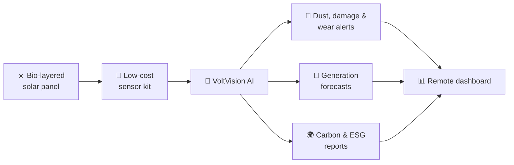

<!-- Add your logo at assets/voltarax-logo.png (PNG with transparent or white background) -->

# Voltarax Private Limited

### Making solar smarter with AI and bio-layered intelligence.

*Bio-layered solar panels with built-in smart monitoring, designed and built in India.*

 

[📧 Email](mailto:voltaraxpvtltd@gmail.com) &nbsp;•&nbsp; [🤝 Partner with us](#-partner-with-us) &nbsp;•&nbsp; [🗺️ Roadmap](#%EF%B8%8F-roadmap) &nbsp;•&nbsp; [✅ Credentials](#-verified-credentials)

---

## 🌞 Who we are

**Voltarax Private Limited** is a Delhi-registered biotech startup (incorporated 23 August 2026) working where **solar energy, bio-based layers and artificial intelligence** meet.

Our monitoring platform, **VoltVision AI**, watches the health of the panel surface so operators can act **before** a loss shows up in the energy bill.

| 🔭 Vision | 🎯 Mission |
|---|---|
| A self-reliant India powered by smarter, longer-lasting clean energy. | To develop bio-layered solar panels with built-in smart monitoring that help every panel generate more clean energy. |

---

## 🧩 What we build

A panel and a platform that work together.

| | Pillar | What it does |
|:-:|---|---|
| 🌿 | **Bio-based layer** | A natural mango and pomegranate extract layer applied to the panel. Monitoring tells operators when it needs renewing. |
| 📡 | **Panel health monitoring** | Low-cost sensors and AI watch for dust, cracks and surface wear, and send alerts before output drops. |
| 🔮 | **Generation forecasts** | Predicts plant output over the next hour, day and week to help operators plan storage and supply. |
| 🌍 | **Carbon & ESG reports** | Turns generated energy into CO₂-offset reports that support sustainability goals. |

### How it fits together

Conceptual overview of the Voltarax platform.

---

## 🇮🇳 Why this matters

| The problem | Where Voltarax fits |
|---|---|
| **Dust and pollution cut solar output.** Studies estimate 17–25% generation loss in parts of India. | Early alerts so cleaning follows need, not a calendar. |
| **Heat, UV and dust wear down panel surfaces**, especially in hot, arid states. | Track the health of the bio-based layer and flag renewal before output drops. |
| **Millions of rooftops need upkeep.** PM Surya Ghar has driven about 40 lakh rooftop installations. | A low-cost kit and remote dashboard that work for operators of any size. |
| **Self-reliance beyond module manufacturing.** Software, sensing and materials are the next frontier. | In-house software and a bio-layer, designed and built in India. |
| **Solar waste is coming.** CEEW estimates ~600 kilotonnes of cumulative PV waste by 2030. | Timely recoating and early fault detection to extend useful panel life. |
| **Variable output strains planning.** | Forecasts from the next hour to the next week. |

Sources: MNRE data via SolarQuarter (Aug 2026); MNRE / PIB on ALMM and the 500 GW target (2025); PM Surya Ghar figures via SolarQuarter (Jul 2026); CEEW solar waste study (2024); Environmental Science & Technology Letters (2017). Alignment with national missions (Atmanirbhar Bharat, 500 GW non-fossil capacity by 2030) is alignment of purpose only and does not imply government endorsement of Voltarax.

---

## 🔬 Where we are

### ✅ Built so far
- Smart monitoring software and dashboard, built and tested on **simulated data**
- Sensor kit designed for the pilot
- DPIIT recognition, MSME registration and a registered design in place

### 🚀 Next, with funding
- Set up the 32-panel pilot at **MNIT Jaipur**
- Collect real field data and validate results
- Strengthen intellectual property and publish findings
- Extend to more sites with partners

> **Transparency note:** our software has so far been tested on simulated data. Real-world validation at the pilot site is the milestone this round is designed to reach.

---

## 🗺️ Roadmap

| Phase | Timeline | Milestone |
|:-:|---|---|
| **1** | Months 1–2 | **Pilot set-up.** Install the monitoring kit on the 32-panel array at MNIT Jaipur and start live data. |
| **2** | Months 3–4 | **Field data.** Collect real-world data and tune monitoring to the site. |
| **3** | Month 5 | **Validation & IP.** Validate results, publish findings, strengthen intellectual property. |
| **4** | Beyond | **Scale.** More sites, more partners, wider rollout across India. |

---

## ✅ Verified credentials

| Credential | Details |
|---|---|
| **Incorporation** | Private Limited Company, 23 Aug 2026 |
| **DPIIT Startup Recognition** | Certificate no. `DIPP285459` · issued 28 Sep 2026 · valid up to 22 Aug 2036 · sector: Renewable Solar Energy |
| **MSME (Udyam) Registration** | `UDYAM-DL-06-0228493` · Micro enterprise, manufacturing (NIC 26109) |
| **Registered Design** | No. `487411-001`, class 13-02, "Solar Panel Plate" · issued 15 Jan 2026 under the Designs Act, 2000 · registered in the names of Delhi Technological University, Prof. Jai Gopal Sharma, Er. Shubhika and Er. Pradeep Patel |

Original certificates are available on request during diligence.

---

## 👥 Team

| | Name | Role |
|:-:|---|---|
| 👩‍🔬 | **Er. Shubhika** | Director & Founder. Leads Voltarax and sets the direction of research and growth. |
| 🧑‍💻 | **Rohan** | Team Member |
| 🧑‍💻 | **Manodeep** | Team Member |
| 🧑‍🔧 | **Er. Pradeep Patel** | Team Member |
| 🧑‍🔧 | **Er. Dinesh Kumar** | Team Member |
| 🎓 | **Prof. Jai Gopal Sharma** | Mentor |

---

## 🤝 Partner with us

Help us take bio-based solar from pilot to scale.

| | Who | How you can help |
|:-:|---|---|
| 💼 | **Angel investors** | Seed funding for the MNIT Jaipur pilot, field validation and IP. Round details are shared directly with interested investors. |
| 🏭 | **Pilot clients** | Solar plant, rooftop and EPC partners who can host a pilot and share operating feedback. |
| 🎓 | **DTU alumni network** | Mentorship, customer introductions and advice on scaling a biotech company from campus to market. |

**Next steps:** `Intro call` → `Walkthrough` → `Diligence` → `Pilot or investment`

---

## 📬 Get in touch

| | |
|---|---|
| **Contact** | Shubhika, Director & Founder |
| **Email** | [voltaraxpvtltd@gmail.com](mailto:voltaraxpvtltd@gmail.com) |
| **Registered office** | 171, 3rd Floor, Block A, Shastri Nagar, Delhi 110052 |
| **Pilot site** | MNIT Jaipur, Rajasthan |

---

**Academic & incubation ecosystem**
Delhi Technological University &nbsp;•&nbsp; DTU Innovation & Incubation Foundation

 

⚡ POWERING A SUSTAINABLE FUTURE ⚡

© 2026 Voltarax Private Limited. All rights reserved.

